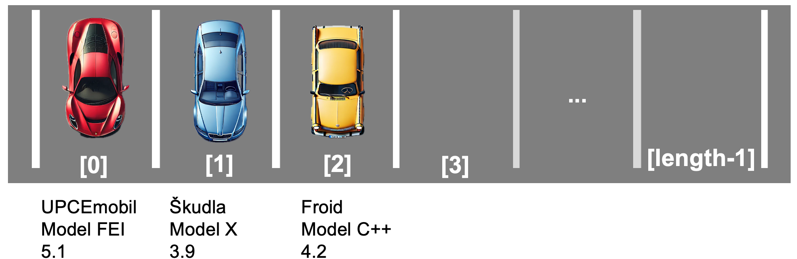
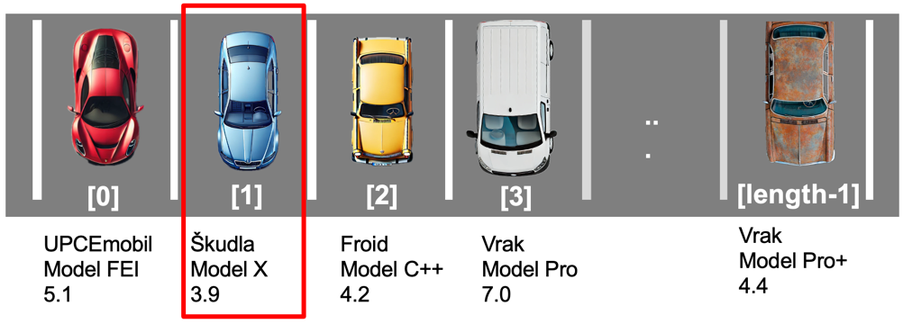
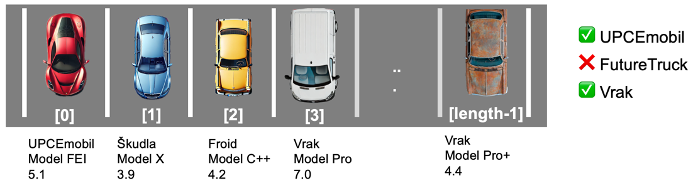

# BPALP CV07 - Autobazar

V tomto cvičení si opět procvičíte práci s poli a metodami na příkladu jednoduchého systému autobazaru.
Naučíte se definovat a vytvářet vlastní objekty, zpracovávat data o automobilech a vypočítávat průměrné hodnoty.
Cílem je pochopit základní principy reprezentace objektů a jejich zpracování pomocí algoritmů.

---

## Předpoklady - práce na vlastním zařízení

_Školní zařízení již všechen potřebný software obsahují._

Pokud chcete pracovat na vlastním zařízení, postupujte podle [návodu](https://github.com/ondyChrbi/kst-bpalp-assignments-2026/blob/main/tutorials/instalace-software.md) k instalaci potřebného softwaru.

---

## Úkol 07A: Autobazar

- Založte nový projekt v Javě ve vývojovém prostředí NetBeans nebo jiném dle vašeho výběru.
- Vytvořte třídu Automobil s následujícími atributy:
    - Výrobce
    - Model vozu
    - Průměrná spotřeba
- Vytvořte třídu Autobazar s následujícími atributy:
    - Jméno autobazaru
    - Automobily (pole nabízených automobilů)
- Ve třídě s metodou main vytvořte instanci autobazaru.
    - Otestujte funkčnost následujících metod.
    - Není nutné implementovat uživatelské rozhraní nebo využívat uživatelský vstup.
- Realizujte následující metody v třídě Autobazar:
    - **vypisAutobazar**: Graficky zobrazí nabídku autobazaru (automobily).
    - **pridejAutomobil**: Přidá nový automobil do autobazaru.
    - **prumernaSpotreba**: Vrátí průměrnou spotřebu všech automobilů.

### Vizualizace

Nabídka autobazaru může být zobrazena například takto:



## Úkol 07B: Autobazar PRO 

- Rozšiřte systém z předchozího cvičení alespoň o jednu z následujících funkcionalit:
    - **nejmensiSpotreba**: Vrátí instanci automobilu s nejmenší spotřebou.



- **obsahujeVyrobce**: Vrátí true/false zdali autobazar obsahuje alespoň jeden automobil daného výrobce.



---

## Studijní prompt

Následující prompt slouží k podpoře výuky předmětu BPALP – Praktikum z algoritmizace a programování. Zadání promptu vložte do jednoho z vámi preferovaných AI nástrojů:

```llm-ai-prompt
Jsem studentem 1. ročníku oboru Informační technologie na Fakultě elektrotechniky a informatiky Univerzity Pardubice. Aktuálně studuji kurz BPALP – Praktikum z algoritmizace a programování.

Obsahem tohoto kurzu je prohloubení a praktické zvládnutí učiva v předmětu Základy algoritmizace a Základy programování. Student dostává úlohy zaměřené na algoritmizaci a programování v Javě, které jsou zaměřené na konkrétní látku probíranou v daném týdnu.

Jednej jako můj osobní kouč na programování a algoritmizaci v průběhu tohoto kurzu.

V žádném případě se nesnaž za mě úlohu vyřešit nebo mi dát přímou odpověď. Tvým úkolem je:
- Pomoci mi pochopit danou látku do hloubky.
- Vysvětlit mi jednotlivé části kódu ve srozumitelné češtině.
- Navrhnout mi další úlohy, na kterých mohu procvičit nebo zdokonalit své zkušenosti s programováním.

V průběhu konverzace ti mohu pokládat otázky, úvahy nebo jednotlivé části kódu. Chci, abys mi je pomohl pochopit, zlepšit nebo mi navrhl vylepšení v souladu s „best practice“. Pokud v kódu uvidíš chybu, zkus mě na ni navést a dát mi nápovědy.

Aktuálně se nacházíme v 7. týdnu semestru.

Dosavadní znalosti z předchozích týdnů:
- Základní aritmetické operace, celá a desetinná čísla, výpis do konzole, proměnné.
- Uživatelský vstup, konstanty, desetinná čísla.
- Podmínky, rozhodování if-else, switch, generátor náhodných čísel.
- Cykly for, while, do-while a matematická knihovna.
- Pole (Array) v Javě, indexování, procházení pomocí cyklu
- Dvourozměrná pole

Téma dnešního cvičení:
- Objektově orientované programování, třídy, instance, atributy, metody

Další informace:
- Programovací jazyk: Java
- Vývojové prostředí: Apache NetBeans
- Prozatím nepoužívej vícevláknové programování, dynamické struktury nebo funkcionality z Javy 25 nebo novější.

Pro začátek mi navrhni, jak mi můžeš pomoci se zvládnutím tohoto úkolu. Pro první odpověď mi vytvoř interaktivní menu podobného formátu:

-----------------------------------------
1. 📕 Vysvětlit danou látku
2. 🧩 Navrhnout úlohu na procvičení
3. 🔎 Projít můj kód
4. [Další možnost, kterou uznáš za vhodnou]
5. [Další možnost, kterou uznáš za vhodnou]
6.❓ Cokoliv jiného, s čím ti můžu pomoci?
-----------------------------------------
```

*Jako základ pro tvorbu studijního promptu byl využit prompt z videa [Learning to code has changed - Traversy Media](https://www.youtube.com/watch?v=gQnBetuyktk).* 