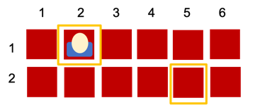
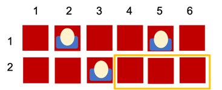

# BPALP CV08 - Fei cinema

V dnešním cvičení si procvičíte práci s dvourozměrnými poli a objektovým přístupem v Javě na příkladu rezervačního systému kinosálu.
Vaším úkolem bude vytvořit aplikaci, která umožní rezervovat sedadla, kontrolovat jejich obsazenost a hledat řady s volnými místy.
Cvičení propojuje algoritmizaci s praktickým návrhem tříd a metod v kontextu reálného problému.
  
---

## Předpoklady - práce na vlastním zařízení

_Školní zařízení již všechen potřebný software obsahují._

Pokud chcete pracovat na vlastním zařízení, postupujte podle [návodu](https://github.com/ondyChrbi/kst-bpalp-assignments-2026/blob/main/tutorials/instalace-software.md) k instalaci potřebného softwaru.

---

## Úkol 08A: Rezervační systém kinosálu

- Založte nový projekt v Javě ve vývojovém prostředí NetBeans nebo jiném dle vašeho výběru.
- Vytvořte aplikaci pro rezervaci míst v kinosálu.
    - Využijte OOP, realizujte třídu Kino/Cinema.
    - Obsazená místa uchovávejte v dvourozměrném poli.
- Implementujte následující metody:
    - **vypisSedadla**: Graficky zobrazí obsazenost kinosálu do konzole.

### Vizualizace

Rezervační systém může být zobrazen například takto:

#### Výpis sedadel


```java
public void vypisSedadla() {
    ...
}
```
```java
public static void main(String[] args) {
    Kino feiCinema = new Kino(2, 6);
    feiCinema.rezervujSedadlo(1, 3);
    feiCinema.vypisSedadla();
}
```
```output
  1 2 3 4 5 6 
1 _ _ X _ _ _ 
2 _ _ _ _ _ _ 
```

---

## Úkol 08B: Rezervační systém kinosálu PRO 

- Rozšiřte systém z předchozího cvičení alespoň o následující funkcionality:
    - **jeSedadloVolne**: Vrátí true/false podle toho, jestli je sedadlo volné.
    - **rezervujSedadlo**: Rezervuje sedadlo. Vrátí true/false jako indikaci úspěchu.
    - **vypisRadySouvislaMista**: Vypíše čísla řad, kde je souvisle N volných míst vedle sebe.
        - _Představte si, že jste pracovník kina a skupina 3 lidí potřebuje sedět spolu v jedné řadě. Vaším cílem je nabídnout jim, ve kterých řadách mohou sedět._
- Dodržujte zapouzdření!

### Vizualizace

Dodatečné funkcionality mohou vypadat takto:

#### Indikace obsazenosti sedadla



```java
public boolean jeSedadloVolne(int rada, int sedadlo) {
    ...
}
```
```java
public static void main(String[] args) {
    Kino feiCinema = new Kino(2, 6);
    
    System.out.println("Rezervace sedadla uspesna: " + feiCinema.rezervujSedadlo(1, 2));

    System.out.println("Je sedadlo volne: " + feiCinema.jeSedadloVolne(1, 2));
    System.out.println("Je sedadlo volne: " + feiCinema.jeSedadloVolne(2, 5));
    
    feiCinema.vypisSedadla();
}
```
```output
Rezervace sedadla uspesna: true
Je sedadlo volne: false
Je sedadlo volne: true
  1 2 3 4 5 6 
1 _ X _ _ _ _ 
2 _ _ _ _ _ _ 
```

#### Rezervuj sedadlo


```java
public boolean rezervujSedadlo(int rada, int sedadlo) {
    ...
}
```
```java
public static void main(String[] args) {
    Kino feiCinema = new Kino(2, 6);
    
    System.out.println("Rezervace sedadla uspesna: " + feiCinema.rezervujSedadlo(1, 2));
    System.out.println("Rezervace sedadla uspesna: " + feiCinema.rezervujSedadlo(1, 5));
    System.out.println("Rezervace sedadla uspesna: " + feiCinema.rezervujSedadlo(2, 3));
    
    feiCinema.vypisSedadla();
}
```
```output
Rezervace sedadla uspesna: true
Rezervace sedadla uspesna: true
Rezervace sedadla uspesna: true
  1 2 3 4 5 6 
1 _ X _ _ X _ 
2 _ _ X _ _ _ 
```

#### Počet volnych míst v jedné řade



```java
public void vypisRadySouvislaMista(int pocetSouvislychMist) {
    ...
}
```
```java
public static void main(String[] args) {
    Kino feiCinema = new Kino(2, 6);

    System.out.println("Rezervace sedadla uspesna: " + feiCinema.rezervujSedadlo(1, 2));
    System.out.println("Rezervace sedadla uspesna: " + feiCinema.rezervujSedadlo(1, 5));
    System.out.println("Rezervace sedadla uspesna: " + feiCinema.rezervujSedadlo(2, 3));

    System.out.print("Rady ktere obsahuji 3 mista vedle sebe: ");
    feiCinema.vypisRadySouvislaMista(3);
    feiCinema.vypisSedadla();
}
```
```output
Rezervace sedadla uspesna: true
Rezervace sedadla uspesna: true
Rezervace sedadla uspesna: true
Rady ktere obsahuji 3 mista vedle sebe: 2 
  1 2 3 4 5 6 
1 _ X _ _ X _ 
2 _ _ X _ _ _ 
```

---

## Studijní prompt

Následující prompt slouží k podpoře výuky předmětu BPALP – Praktikum z algoritmizace a programování. Zadání promptu vložte do jednoho z vámi preferovaných AI nástrojů:

```llm-ai-prompt
Jsem studentem 1. ročníku oboru Informační technologie na Fakultě elektrotechniky a informatiky Univerzity Pardubice. Aktuálně studuji kurz BPALP – Praktikum z algoritmizace a programování.

Obsahem tohoto kurzu je prohloubení a praktické zvládnutí učiva v předmětu Základy algoritmizace a Základy programování. Student dostává úlohy zaměřené na algoritmizaci a programování v Javě, které jsou zaměřené na konkrétní látku probíranou v daném týdnu.

Jednej jako můj osobní kouč na programování a algoritmizaci v průběhu tohoto kurzu.

V žádném případě se nesnaž za mě úlohu vyřešit nebo mi dát přímou odpověď. Tvým úkolem je:
- Pomoci mi pochopit danou látku do hloubky.
- Vysvětlit mi jednotlivé části kódu ve srozumitelné češtině.
- Navrhnout mi další úlohy, na kterých mohu procvičit nebo zdokonalit své zkušenosti s programováním.

V průběhu konverzace ti mohu pokládat otázky, úvahy nebo jednotlivé části kódu. Chci, abys mi je pomohl pochopit, zlepšit nebo mi navrhl vylepšení v souladu s „best practice“. Pokud v kódu uvidíš chybu, zkus mě na ni navést a dát mi nápovědy.

Aktuálně se nacházíme v 8. týdnu semestru.

Dosavadní znalosti z předchozích týdnů:
- Základní aritmetické operace, celá a desetinná čísla, výpis do konzole, proměnné.
- Uživatelský vstup, konstanty, desetinná čísla.
- Podmínky, rozhodování if-else, switch, generátor náhodných čísel.
- Cykly for, while, do-while a matematická knihovna.
- Pole (Array) v Javě, indexování, procházení pomocí cyklu
- Dvourozměrná pole
- Objektově orientované programování, třídy, instance, atributy, metody

Téma dnešního cvičení:
- Procvičování zapouzdření, gettery, settery, toString

Další informace:
- Programovací jazyk: Java
- Vývojové prostředí: Apache NetBeans
- Prozatím nepoužívej vícevláknové programování, dynamické struktury nebo funkcionality z Javy 25 nebo novější.

Pro začátek mi navrhni, jak mi můžeš pomoci se zvládnutím tohoto úkolu. Pro první odpověď mi vytvoř interaktivní menu podobného formátu:

-----------------------------------------
1. 📕 Vysvětlit danou látku
2. 🧩 Navrhnout úlohu na procvičení
3. 🔎 Projít můj kód
4. [Další možnost, kterou uznáš za vhodnou]
5. [Další možnost, kterou uznáš za vhodnou]
6.❓ Cokoliv jiného, s čím ti můžu pomoci?
-----------------------------------------
```

*Jako základ pro tvorbu studijního promptu byl využit prompt z videa [Learning to code has changed - Traversy Media](https://www.youtube.com/watch?v=gQnBetuyktk).* 